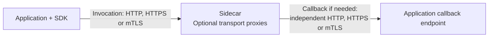
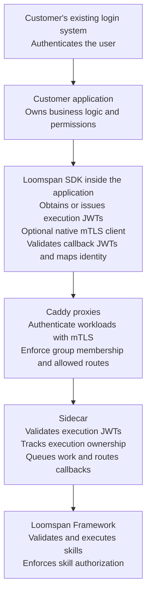
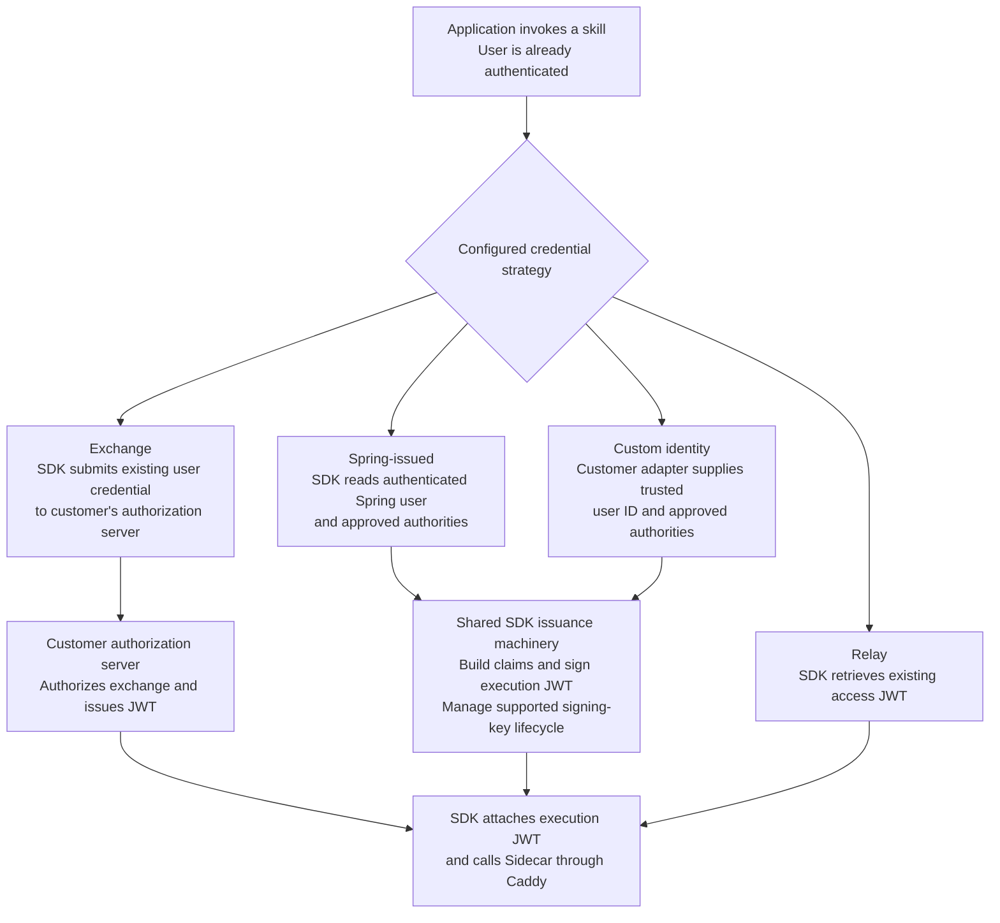
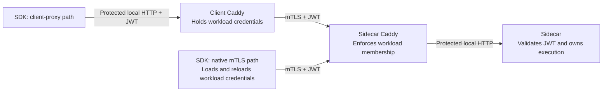
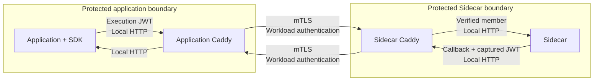
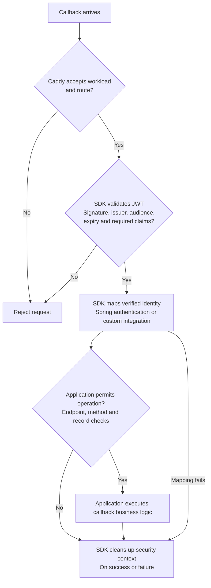

# Java and Spring Security SDK v1 roadmap

Updated 2026-10-15. Agreed v1 transport scope: **protected local HTTP, HTTPS and mTLS,
selected independently for invocation and callbacks**. Java and Spring Security come first; other languages follow after this
integration is proven. Across the supported transport compositions, the SDK manages JWT and user
security integration across all four credential strategies: Relay, Exchange,
Spring-issued and Custom identity. Both client-Caddy and SDK-native outbound mTLS
are required in v1. Caddy is optional for direct HTTP/HTTPS; the agreed mTLS reference
paths retain Sidecar Caddy. This roadmap defines planned
behavior, not completed support.

**Development policy: destructively replace superseded contracts, code and schemas.
Do not add compatibility shims, legacy adapters, dual API paths or migration machinery
solely to preserve obsolete behavior. Apply the [design lens](../design-lens.md#simplicity-and-technical-debt).
Choose the simplest complete solution.** No development-data reset is required by
this documentation update; future resets must document their scope and impact.
Planning does not authorize deletion of deployed data.

## Outcome and boundaries

Make calling skills and receiving REST-skill callbacks convenient for an application
that already authenticates its users. Customers retain their login infrastructure
and business authorization. **Loomspan never handles application user login or supplies,
hosts or replaces the customer's login/authorization server.** End users keep their
existing login flow. SDK-issued execution JWTs represent authentication already
established by the application; they do not create a login service. This boundary
concerns customer application authentication, not Sidecar's separate management login.
Setup simplicity is the primary driver; reuse of established security implementations
and documented architectures is nearly as important. Do not invent a security protocol.
The [supporting research](2026-10-11-established-security-architectures.md)
records the deployment patterns and independently selectable transport options.

## V1 transport composition and deployment patterns

The [trust/bootstrap/lifecycle reference](2026-10-15-sdk-v1-trust-bootstrap-lifecycle-reference.md)
now settles PR-8.0.2's concrete source/state/admin, signer/endpoint/export, Smallstep
bootstrap and separate JWT/TLS lifecycle contracts. Its
[named planned scenarios](2026-10-15-sdk-v1-trust-bootstrap-lifecycle-scenarios.md)
assign initial enforcement to Phase 1, group extension to Phase 2 and lifecycle
mechanisms/stress to Phase 3. It supersedes the corresponding illustrative settings
and open mechanism statements below, preserving acceptance requirements. These are
contracts, not implemented support; PR-8.0.3 still owns pinned runtime/deployment
versions, exact commands/topologies and the consolidated evidence matrix.

Invocation (SDK to Sidecar) and callbacks (Sidecar to application) independently
select HTTP, HTTPS or mTLS. Proxy placement is another independent choice, as is the
JWT credential strategy. This supersedes the earlier restriction to two fixed security
options; isolated and two-way mTLS trusted-group deployments remain useful reference
patterns, not SDK security modes restricting transport combinations.

| Transport | Intended deployment | Required boundary |
| --- | --- | --- |
| HTTP | Same-host or same-container deployments with protected local communication. | Bind/restrict access so unintended workloads cannot reach the endpoint or borrow an outbound proxy identity. Co-location alone is not authentication. |
| HTTPS | Internal trusted networks, or other deployments accepting authorized JWT holders without a separate client-certificate requirement. | Validate server certificate chain and hostname; retain JWT validation and application authorization. Network trust does not disable either check. |
| mTLS | Deployments requiring independent workload identity/membership. | Validate server and client certificates and enforce explicit peer policy in addition to JWT/user authorization. |

All three transports and mixed invocation/callback combinations are v1 requirements.
Examples include local HTTP in both directions, HTTPS in both directions, and mTLS
invocation with a protected local HTTP callback. Each configured hop must satisfy its
own boundary; HTTPS in one direction does not protect plaintext in the other. Plain
HTTP is not the default for an arbitrary internal network. There is no automatic
downgrade after a TLS or authentication failure.

Caddy is not required for protected direct HTTP. HTTPS can terminate at Caddy,
existing ingress or the application's standard TLS server. The SDK supports direct
HTTPS; Sidecar uses its existing HTTP client/TLS integration for direct callbacks where
appropriate. Any unsupported contract must be planned explicitly. For mTLS invocation,
both agreed client-Caddy and SDK-native paths below remain required. Callback server
TLS belongs to the application's ingress/server, not to a new server inside the SDK.
No callback listener or callback TLS setup is required when no REST callback is used.



Every path retains execution JWT validation, issuer/subject ownership, supported
credential propagation and callback user authorization. Transport choice grants no
additional user permissions. All four credential strategies apply to these paths.

### 1. Isolated Sidecar — default

One logical application has a dedicated Sidecar deployment. Admission is restricted
to that application, and callbacks go only to its explicitly configured targets.
Isolation must be enforced through the documented deployment's identity and access
controls. Loopback limits network reachability but does not identify a local process.

The default must be usable without manual key/certificate exchange, certificate-tool
commands or a new identity server. SDK/Sidecar deployment tooling should configure
trust and credential lifecycle through an established provisioning mechanism. Define
and validate one concrete deployment recipe before promising automatic setup.
An isolated deployment can run locally or in any supported cloud environment.

**Agreed default for isolated Docker Compose setups:** automatically provision unique,
deployment-specific JWT signing keys for Spring-issued and Custom identity. On first
initialization, deployment tooling generates a cryptographically random asymmetric key
pair, delivers the private key only to the issuing application's protected signing
storage, and configures Sidecar with the public verification material and approved
issuer/audience settings. Provision callback-validator trust separately when callbacks
are used. Persist keys and issuer identity across ordinary restarts; do not regenerate
them on each container start. Use one signing-state owner shared with the SDK's managed
key lifecycle rather than competing generators. Sidecar does not mint tokens or hold
the application's private signing key.

No shared/example private key, unsigned-token mode or authentication bypass is a default.
Unpublished ports alone do not establish workload isolation. Relay and Exchange continue
using their configured provider's keys and trust; automatic local issuance must not
silently replace those strategies. JWT-key provisioning is separate from TLS/mTLS
certificate provisioning and does not change independently selected transports or peer
policy. Public-key upload and administrator-configured JWKS URLs remain supported
alternatives for customer-managed trust, not prerequisites for the generated-key default.

This is a deployment-initialization recipe, not a management bearer-token permission to
change trust. Phase 0 must define how operator-selected bootstrap trust is installed
under the chosen file/database configuration authority without creating a runtime
authentication bypass. Subsequent management trust changes retain the interactive-admin
restriction; repeated bootstrap must not overwrite existing trust or restore withdrawn
keys. Select the concrete provisioning mechanism, storage permissions, startup ordering,
public-key export and failure/recovery behavior in planning. Test first start, unique
keys across independent deployments, restart persistence, correct callback trust, private-
key access boundaries and safe failure on missing/corrupt existing state. Explicit reset
must document its impact; never silently reset identity or weaken validation. Automatic
Compose setup remains planned support until real integration evidence proves the recipe.

Existing customer certificates and trust configuration must also be usable. A lack
of existing customer PKI must not silently disable authentication or verification.
Pairing persists through ordinary restarts; invalid credentials cause actionable
errors rather than permissive fallback. Exact provisioning and renewal details remain
implementation-planning work within this option.

### 2. Two-way mTLS trusted group — reference deployment

Several cooperating applications and Sidecar form an explicitly authorized group.
Each workload has its own certificate/private key. mTLS authenticates peers on both
application-to-Sidecar and Sidecar-to-application connections; membership policy
restricts which authenticated identities may participate.

The 2026-10-15 clarification reserves the **two-way mTLS trusted-group guarantee**
for configurations using mTLS and explicit peer policy on both invocation and callback
connections. Transport selection remains independent. Mixed configurations are supported
and described by their actual transports, for example **mTLS invocation with HTTPS
callbacks**; they do not inherit the two-way guarantee or require another SDK mode.

| Connection | Guarantee in a mixed mTLS-invocation/HTTPS-callback configuration |
| --- | --- |
| Invocation over mTLS | The application verifies Sidecar's server identity; Sidecar's proxy authenticates the calling workload and enforces membership. Sidecar separately validates the execution JWT. |
| Callback over HTTPS | Sidecar verifies the callback server's identity; the application validates the user JWT and applies business authorization. Ordinary HTTPS does not authenticate Sidecar as the calling workload, and the passed-through user JWT does not prove that Sidecar presented it. |

If the callback requires authenticated Sidecar workload identity, use callback mTLS
with peer policy, or another mechanism only after it is explicitly planned and
supported. Protected local HTTP and other mixed compositions retain their own hop's
documented boundary; stronger invocation transport does not strengthen the callback.
For workloads without callbacks, only invocation protection applies; no callback
listener or callback mTLS is required, and no two-way guarantee is claimed.

Trust in a broad corporate CA alone is insufficient to establish group membership.
Use an explicit identity policy or suitably restricted certificate issuance and trust.
Sidecar's deployment admits work only from authorized members and permits callbacks
only to approved group targets. Receiving applications rely on their proxies to
authenticate Sidecar's workload and on its deployment to enforce group admission.
They may accept otherwise-authorized work initiated by any member. **This option
provides no origin-only callback guarantee or isolation between mutually untrusted
applications.** Group membership grants no blanket user or record permissions.

Use existing enterprise PKI or service-mesh enforcement where supplied. The agreed
direction is to enforce workload authentication and group membership in deployment
proxies, keeping certificate handling and membership policy outside Sidecar Java code.
Membership removal, certificate expiry and renewal must have defined and tested behavior.

### Agreed direction: two v1 mTLS client paths

Caddy is the selected direction for the reference deployment because the existing
[production deployment](../../../examples/production/README.md) already terminates
inbound HTTPS at Caddy and forwards HTTP to unpublished Sidecar ports. It supplies
internal-CA, public ACME, DNS-challenge and operator-supplied certificate configurations.
This is an existing foundation, not evidence of a completed mTLS group.

Caddy supports incoming client-certificate verification and outgoing client
authentication through its reverse-proxy transport. Both invocation arrangements are
required v1 scope within either deployment option and across all four credential
strategies; neither is a deferred extension:

```text
SDK -> client Caddy -> mTLS -> Sidecar Caddy -> Sidecar
SDK -> mTLS -> Sidecar Caddy -> Sidecar
```

These are agreed requirements, not completed support. With client Caddy, the proxy
holds workload credentials and the SDK uses protected local HTTP. With SDK-native
mTLS, the SDK's HTTP client uses provisioned workload credentials and verifies the
Sidecar endpoint directly. Sidecar Caddy enforces admission in both paths; Sidecar
Java remains unaware of peer certificates. Select the path explicitly, with no
fallback to weaker transport after authentication failure.

Deployment infrastructure owns enrollment, renewal and material delivery. The native
SDK path owns secure loading/reloading, server certificate and hostname verification,
connection replacement and cleanup. Certificate renewal, private-key rotation and CA
trust rotation are separate lifecycle operations. Both paths need tested renewal,
expiry/recovery and member removal, including existing connections. Exact provisioning
and reload contracts remain planning work; two Caddy instances do not automatically
establish mutual trust or client enrollment.

Outbound client mTLS does not provide callback ingress. Workloads without REST callbacks
need no callback listener or callback TLS setup; status/result polling remains outbound.
The selected invocation path still applies: client-Caddy invocation requires client
Caddy and its protected local proxy listener even without callbacks. SDK-native mTLS
needs no client Caddy for invocation. Both mTLS paths retain Sidecar Caddy; omitting
callback ingress does not remove invocation proxies or their security requirements.
An application that elects to host its own JWKS endpoint needs an existing web listener
for key retrieval. Uploaded public keys or separately hosted JWKS permit outbound-only
applications without callbacks.
When callbacks are used, protect the receiving endpoint through client Caddy, existing
ingress or application-server mTLS, with a documented and tested recipe. SDK-native
outbound mTLS does not itself create a TLS server. Callback ingress selection is separate
from the invocation path. Local HTTP is acceptable only inside a protected boundary
that prevents bypass and borrowing another workload's outbound identity.

- Enforce explicit membership at the proxies using restricted issuance/trust or an
  explicit member policy; a broad corporate CA alone is insufficient.
- Prevent direct access around inbound proxies and unauthorized use of outbound
  routes. Restrict outbound routes to approved destinations; do not provide an open proxy.
- Keep peer certificate interpretation and membership enforcement out of Sidecar.
  Do not replace them with caller-controlled identity headers. Sidecar retains its
  configured REST routing, execution JWT validation, ownership and credential passthrough;
  applications retain user and record authorization.
- Treat provisioning, renewal, trust updates and member removal as deployment
  responsibilities. Define removal behavior for existing connections as well as new
  handshakes. Separate management/browser access from workload mTLS requirements.

This direction can also enforce the dedicated application's boundary in the isolated
option. It introduces no third security mode. Caddy's mTLS capabilities do not by
themselves provide automatic enrollment or user-identity propagation. Validate exact
configuration against the currently pinned Caddy 2.10.2 before claiming support;
no complete proxy-managed recipe or automated bootstrap is yet proven.

## Shared security requirements

- Service identity and user identity are separate. mTLS does not supply a user's
  roles. Preserve existing Spring authentication and validate the execution credential
  before establishing the callback's native Spring identity and authorities.
- Implement the four explicitly selected SDK credential strategies below within
  the supported transport compositions. Their inclusion is agreed; exact contracts and supported
  configurations still need design and tests. Do not promise every customer
  authentication configuration before documenting and testing it.
- Existing endpoint, method and record-level authorization must remain effective.
  Map only trusted identity/authority data; never derive identity from model input.
  Do not serialize arbitrary security objects or weaken existing login routes.
- Isolate users across concurrent and asynchronous requests; clean up callback context.
  Define credential expiry during queueing and callbacks, permission freshness and
  logout behavior. Never fall back to a more privileged service identity.
- Keep TLS keys and user-token signing keys distinct. Protect private material and
  keep credentials out of logs, prompts and source-controlled configuration.
- Use maintained implementations and a documented reference architecture. Verify
  composition with real Sidecar tests and independent security-focused review.

## SDK-managed JWT and user security

The [identity/callback reference](2026-10-15-sdk-v1-identity-callback-reference.md)
now defines the concrete PR-8.0.1 design: strategy/API/settings names, Keycloak
26.4.0 exchange, token profiles, authority freshness and both callback recipes.
Its [planned scenario matrix](2026-10-15-sdk-v1-identity-callback-scenarios.md)
preserves the detailed obligations below. It supersedes corresponding illustrative
names/configuration and open design statements here, not acceptance requirements.
These contracts remain subject to independent review and are not implemented support.

The SDK should manage as much JWT and user-security plumbing as possible. Customers
select a credential strategy and configure trust, retaining their existing login and
business authorization. Supported integrations must not require customers to write
JWT construction, signing, request attachment or callback authentication filters.
Configuration or equivalent Java initialization selects the strategy explicitly;
automatic wiring may support that selection but must never switch strategies on failure.

| Credential strategy | SDK responsibility |
| --- | --- |
| Relay | Retrieve an existing compatible access JWT from the supported authenticated context and attach it to Sidecar requests. |
| Exchange | Use a configured authorization server to obtain an appropriate execution JWT on the user's behalf and attach it to requests. |
| Spring-issued | Read the authenticated Spring user and selected authorities, then generate a short-lived execution JWT using configured application signing keys. |
| Custom identity | Invoke trusted application-provided identity/authority code, then use the same issuance machinery as Spring-issued. |

All four are planned v1 scope, not deferred extensions. They are credential strategies,
not additional deployment security modes. Exchange requires a server that supports
and authorizes the selected exchange flow and produces a compatible token; OAuth login
alone is insufficient. Relay must not silently reissue an incompatible token, and
failed exchange must not fall back to application issuance or service identity.

Spring-issued and Custom identity share claim construction, signing, lifetime and
validation machinery built on maintained JWT implementations. Prefer asymmetric signing:
the issuing application holds the private key; Sidecar and callback validators receive
trusted public verification material. The SDK integrates with provisioned keys and
rotation; deployment establishes issuer trust and protects key material. Caddy's TLS
keys and certificate trust remain separate from JWT signing keys and issuer trust.

For every strategy, the SDK validates callback credentials before creating native
Spring authentication or invoking the custom receiving integration. Define signature,
allowed algorithm, issuer, audience, time and required-claim checks for both admission
and callbacks. Map only verified identity and approved authorities. Offer explicit
principal mapping or lookup hooks for application-specific identity requirements;
never serialize passwords, sessions or arbitrary Spring security objects into tokens.
Trusted identity providers are server-side integrations, not model inputs or unverified
request fields. Existing endpoint, method and record-level authorization remains active.

The SDK owns request credential attachment, supported asynchronous context propagation,
callback context isolation and cleanup, and actionable authentication failures. Settle
permission snapshots versus live lookup, disabled-account and logout behavior, expiry
during queueing/callbacks, and key rotation explicitly. A new credential for later client
requests must not imply that an already-admitted execution's captured JWT is refreshed.
These choices should become documented SDK behavior/configuration and narrow integration
hooks, rather than security plumbing each customer must implement.

Prove all strategies against existing Sidecar contracts first; change Sidecar only for
demonstrated gaps. Sidecar currently accepts one configured issuer and never mints,
refreshes or exchanges execution JWTs. Several independently issuing group applications
may require a planned trust-contract change. Define who may assert each user's identity
and authorities, and compatible audiences for Sidecar and intended callbacks; mTLS group
membership alone grants no JWT issuer authority. Preserve issuer/subject ownership and
unchanged passthrough unless explicitly revised through planning and the design lens.

### Agreed callback security composition — 2026-10-15

Support two explicitly selected Spring callback security integration options using the
same SDK JWT validation and identity/authority mapping components:

1. **SDK-owned dedicated callback chain:** opt-in configuration for an explicitly
   reserved callback path, such as `/internal/loomspan/**`. Supply narrowly scoped
   bearer authentication, documented chain ordering and a hook for application-owned
   callback authorization. Do not assume rules from another filter chain are inherited.
2. **Application-owned chain:** an SDK-provided configurer contributes callback
   authentication to a customer-owned security chain while the application retains its
   authorization rules. Customers configure normal Spring security; they do not implement
   JWT parsing or custom authentication filters. Scope SDK behavior to designated
   callback requests even when the chain also serves other application routes.

Choose one arrangement for each callback route; do not register competing SDK and
application integrations for the same route. Spring selects the first matching security
chain rather than merging chains. Phase 0 must define matchers, ordering, authorization
hooks and configuration diagnostics, with a documented composition recipe for each
option. Do not promise automatic compatibility with arbitrary existing chains. An SDK
chain must not silently replace stricter application URL rules with mere authentication;
required callback URL rules must be applied in the selected chain. Preserve application
endpoint, method and record authorization in both arrangements.

Callbacks use **bearer-only authentication**. Ignore accompanying session cookies for
callback authentication: never load callback identity from a browser session, fall back
to one when the token is missing/invalid, or combine session identity/authorities with
the bearer identity. A valid token for Alice plus Bob's session cookie authenticates
only Alice. Missing/invalid tokens produce an authentication failure, not a browser
login redirect. Do not create or update a browser security session with callback identity
or mutate the existing session because its cookie accompanied a callback.

Preserve login, session behavior, authorization and CSRF protection on non-callback
routes. Any CSRF exception must be limited to explicitly designated bearer-only callback
requests; do not disable CSRF for the application or a mixed-use chain as a whole.
Guarantee security-context isolation and cleanup on success, rejection, exceptions and
supported asynchronous paths. The optional JWKS endpoint has a separately configured
key-publication access policy; exposing public keys must not permit callback business
requests without authentication or change existing application routes.

Acceptance evidence for **both** options must use an application with existing login,
sessions, CSRF protection and role-restricted routes. Verify callback route selection
and chain precedence, preservation of URL/method/record checks, and rejection when a
valid JWT lacks required authority. Test bearer Alice with session Bob, missing/invalid
bearer tokens with a valid session, cookie-only requests, and valid bearer requests
without cookies. Prove no session fallback, authority merging, callback identity saved
to a session, or browser login redirects for authentication failures. Verify ordinary
browser login/session behavior and CSRF rejection remain intact, callback-only CSRF
exceptions work without weakening neighboring routes, and sequential/concurrent/error
and supported async requests do not leak identity. Test JWKS/callback route separation
and the supported diagnostics for misconfigured overlap/order. These are planned
contracts and evidence, not claims of completed integration.

### Agreed issuer-aware identity and authority mapping — 2026-10-15

Preserve the verified **issuer and subject pair (`iss`, `sub`) as user identity**
through SDK callback authentication and application integration. Sidecar execution
ownership remains that same pair. A username or display-name claim is separate and
must not silently replace the pair; matching usernames, email addresses or subjects
from different issuers do not establish that they identify the same account.

Support multiple roles through explicit mappings from verified claims to Spring
authorities. Roles are separate claims, not embedded in issuer or subject, and changing
roles does not change identity or execution ownership. Configure which claims and role
values each approved issuer may assert and how they map to application authorities.
An identically named role from another issuer grants no authority without an explicit
mapping. Do not blindly copy arbitrary claims into authorities or automatically combine
token roles with local-account permissions. Existing endpoint, method and record-level
authorization remains effective; receiving a mapped role does not bypass those checks.

Provide an optional trusted application bean for local-account resolution. Invoke it
only after JWT validation, supplying the verified issuer and subject, to resolve the
application's native principal. Preserve the originating pair alongside that principal
so it remains available to application code. Without the bean, the default authenticated
identity retains the pair and explicitly mapped authorities without requiring a local
account database. With local-account resolution configured, an unresolved identity or
lookup failure rejects access; do not guess by username/email, create accounts, or fall
back to the default principal. Any deliberate mapping of several external identities to
one local account belongs to trusted application configuration/code, not an SDK account-
linking system. It does not merge Sidecar execution ownership across issuer/subject pairs.

Applications may use configured token-authority mappings or explicitly selected live
account/permission lookup. Exact bean types, principal representation, authority-source
precedence and permission freshness/disabled-account/logout policy remain Phase 0 design
work. Preserve these agreed identity rules regardless of that selection. A renewed token
with the same issuer and subject retains ownership eligibility, subject to current
admission/authorization checks; changing either field does not grant access to executions
owned by the old pair, even when both identities resolve to the same local account.

Acceptance evidence must cover identical subjects from different issuers resolving to
distinct identities; multiple mapped roles; unmapped or differently mapped roles from
another issuer; and role changes without ownership changes. Exercise both default
identity and the optional resolver, successful native-principal resolution, unresolved
accounts/lookup failures, and retention of the verified pair. Prove invalid JWTs never
reach the resolver, matching names/emails do not cause implicit linking, and renewed
same-pair tokens retain ownership while changed-pair tokens cannot read the original
execution. Multi-issuer scenarios require a deliberately planned supported issuer-trust
contract; this decision does not silently expand Sidecar's current single-issuer support.

### Agreed v1 execution-token compatibility — 2026-10-15

V1 supports **ordinary bearer access JWTs**, including bearer JWTs transported over
mTLS. Workload authentication and user-token validation remain independent: mTLS
authenticates an admitted workload, while the JWT establishes verified user identity
and permitted authority. V1 does not bind execution tokens to transport certificates.
This boundary applies to all four credential strategies and to execution admission
and SDK callback validation, regardless of invocation or callback transport.

**ID tokens and other wrong-purpose JWTs are not execution credentials and must be
rejected**, even when signed by a trusted issuer. A valid signature establishes origin
and integrity, not permission to use a token for this API. For each supported issuer/
provider profile, define audience and token-purpose validation that distinguishes access
tokens from login ID tokens and other JWT types. Use documented provider rules, including
type headers or purpose claims where applicable; do not assume every provider uses
`typ: at+jwt`, or that a generic `typ: JWT` establishes access-token purpose. Do not
weaken audience checks or guess purpose from the presence of roles. A provider profile
that cannot reliably distinguish accepted execution credentials is not supported until
its trust/configuration contract is resolved.

Relay must retrieve the access token, never the login ID token. Exchange results must
satisfy the same execution access-token profile; rules for any exchange input remain a
separate provider contract. Spring-issued and Custom identity must issue a documented
execution-token profile that validators can distinguish from other token purposes.
Sidecar admission and SDK callback validation enforce these rules independently of SDK
token selection. Reject incompatibility without relabeling tokens or automatic fallback.

Acceptance tests must reject legitimately signed ID tokens from an otherwise trusted
issuer, wrong-audience access tokens and other wrong-purpose tokens at both admission
and callbacks. Where a provider can issue overlapping audiences, prove its additional
purpose rules prevent substitution rather than relying solely on the wrong-audience
fixture. Test Relay access-token selection, incompatible Exchange results and successful
execution tokens for each supported profile. Exact profiles and error contracts remain
Phase 0 work; rejecting ID tokens is an agreed requirement, not current-code evidence.

**Sender-constrained execution tokens are unsupported and must be explicitly rejected.**
This includes mTLS certificate-bound tokens and DPoP-bound tokens. Do not treat a valid
signature as sufficient when a token carries an unsupported proof-of-possession
requirement. Reject token confirmation (`cnf`) claims rather than ignoring their
binding, including certificate-thumbprint and public-key-thumbprint bindings; reject
DPoP execution authentication rather than accepting it as bearer authentication.
Phase 0 must define the exact supported token profile, detection and error behavior,
including malformed or unknown confirmation methods, with fail-closed server validation.
SDK checks should provide actionable errors but cannot replace server enforcement.
Never strip a binding, share the originating client's private key with Sidecar, or
silently downgrade/fall back to a bearer credential.

Relay requires a compatible bearer access JWT. Exchange must return one through an
explicitly configured, provider-authorized flow; Spring-issued and Custom identity
issue bearer execution JWTs. mTLS authentication to an authorization server does not
itself imply that its returned token is certificate-bound. Support for that client
authentication or a sender-constrained exchange input remains a separate provider
integration question, not a promise made by this execution-token contract.

**Compatibility limitation:** customers requiring certificate-bound or DPoP-bound
execution credentials end to end are not supported in v1. Customers using such tokens
elsewhere can integrate only if their policy and issuer permit a separate compatible
bearer execution token through explicit configuration. Unchanged passthrough cannot
let Sidecar prove possession of the original application's private key on a callback.
Supporting that requirement later needs explicit delegation/callback-credential design;
it is not enabled merely by choosing mTLS transport.

Acceptance evidence must prove ordinary bearer JWT invocation and callbacks over both
required mTLS client paths, alongside the other supported transports. Negative fixtures
must cover certificate-bound and DPoP-bound JWTs presented as Bearer, unsupported DPoP
execution authentication, and malformed/unknown `cnf` values. Valid issuer signatures
or valid workload certificates must not bypass rejection. Test both Sidecar admission
and SDK callback validation, incompatible Relay/Exchange credentials, and absence of
automatic fallback. Document this limitation in setup and compatibility guidance.
These are planned requirements, not claims about existing rejection behavior.

### Agreed unchanged-token passthrough trust boundary — 2026-10-15

Retain unchanged execution-JWT passthrough. Configuring a passthrough callback target
means trusting that service to receive a reusable user credential, not just identity
information. A recipient, or an attacker controlling it, may reuse the token against
Sidecar or another accepting service while it remains valid, if network/workload
admission and authorization permit. It cannot alter signed permissions, but can exercise
the authority already granted. This model is unsuitable for arbitrary third-party
callbacks or isolation between mutually untrusted applications.

Each receiving service and intermediary is another potential disclosure point. A token
may authorize more than one callback needs. Neither its signature nor unchanged
passthrough proves that Sidecar sent a request or that a particular execution authorized
its body. mTLS can reject nonmember workloads holding a stolen token, but does not
prevent reuse by an otherwise authorized member. Where callbacks require Sidecar's
workload identity, enforce a peer policy admitting Sidecar specifically, rather than
all group members. User and record authorization still applies independently.

Required protections:

- Use execution credentials with audiences limited to Sidecar and the necessary callback
  services, and permissions limited to the intended workflow. Relay requires a genuinely
  compatible token; do not weaken audience validation to accommodate a general-purpose
  application token. Unchanged passthrough requires the issuer's original token to cover
  the intended recipients; Sidecar cannot narrow that token's authority.
- Forward credentials only to explicitly configured, approved destinations. Publish
  authority includes configuring and approving REST callback destinations, including
  recipients of unchanged execution JWTs; no separate interactive approval is required.
  Deployment network/peer restrictions still apply. Prevent
  redirects from carrying credentials to other destinations. Credential-handling
  infrastructure must not copy authentication material into business payloads, logs,
  diagnostic history or model inputs; this is not a business-data sanitization promise.
  Use TLS for remote hops and the documented isolation boundary for protected local HTTP.
- Callback applications must validate the JWT and authorize the requested operation and
  record. Use callback mTLS with Sidecar-specific peer policy when authenticated Sidecar
  workload identity is required; a user JWT alone does not establish it.
- Bound token lifetime to reduce the reuse window and explicitly account for queueing
  and callbacks. Expired callback credentials fail explicitly. Sidecar never refreshes
  or exchanges the captured token or substitutes a more privileged service identity.
  A fresh credential for later SDK requests does not update already-admitted work.

Phase 0 must record the trusted recipients, audience/permission model, callback peer
requirements and lifetime policy. Integration/lifecycle acceptance must demonstrate:

- Rejection of nonmember workloads even with a valid JWT where mTLS membership is required;
  rejection of non-Sidecar members at callbacks configured with Sidecar-only peer policy.
- Rejection of wrong audiences, expired callback tokens and unauthorized operations or
  records, with no fallback credential or privilege escalation.
- No credential delivery to unapproved redirect destinations, and no infrastructure-
  introduced fixture credential leakage into captured application/proxy logs, diagnostics
  or model-bound inputs. Keep authentication fixtures separate from business data for
  these checks; caller-supplied or callback-returned secrets are not redaction test cases.
- The residual limit: a controlled approved recipient can reuse a still-valid fixture
  token where workload admission, audience and user permissions allow. Do not claim
  single-use tokens, execution-bound requests or replay prevention from passthrough/mTLS.
- Independent callback authorization and explicit callback-expiry failure after queueing;
  the credential captured by admitted work remains unchanged despite later SDK renewal.

Use local, deterministic integration tests with no live external-service dependency,
as defined below. If future requirements demand
that callback recipients cannot obtain credentials usable against Sidecar, unchanged
passthrough cannot meet them. A separate narrowly scoped callback credential would need
explicit contract planning; this decision introduces no Sidecar token minting or exchange.

### V1 business-data responsibility and no sanitization

Apply the [design lens's diagnostic/data boundary](../design-lens.md#preserve-the-available-diagnostic-contract).
The SDK, Sidecar and console do not classify, mask, redact or sanitize caller-supplied
inputs/prompts or callback-returned business data. If an application includes a token,
password or other sensitive value in that data, responsibility for including it remains
with that application. Such content may reach model context, results and selected
diagnostics through normal processing; v1 does not detect or remove it on the caller's
behalf. Preserve existing result and diagnostic contracts rather than silently rewriting
content. Access controls and visibility boundaries still apply.

This does not permit infrastructure leakage: SDK/Sidecar/framework security plumbing
and reference proxies must not introduce authentication credentials, private keys or
internal security context into business data, model inputs, logs or diagnostics.
Supported authentication headers and verified principal/authority integration remain
separate from business payloads. Tests must distinguish infrastructure-introduced
disclosure from data deliberately supplied by a caller or callback, using synthetic
fixtures rather than real secrets. Do not add a sanitizer or require blanket secret
absence from arbitrary business content. Preserve existing framework-owned diagnostic
projection behavior through its public contract without expanding it into new redaction.

## Proposed component and request flows

These diagrams record the responsibility boundaries agreed on 2026-10-14. They
describe proposed design, not implemented or validated SDK/Caddy integration. They
illustrate the mTLS reference paths; the transport-composition diagram above also
covers HTTP/HTTPS alternatives. The callback path is used only when execution
requires one. Proxy placement and lifecycle details remain subject to the planning
and evidence requirements above. They do not introduce a new deployment option.

### Component responsibilities



Login remains entirely with the customer. The SDK uses established authentication;
the application retains business authorization. The SDK is an application library,
not a new network service. Sidecar and Framework responsibilities are distinct even
though Framework runs inside Sidecar.

### Four explicitly selected credential strategies



These branches represent configuration choices, not automatic fallback. A failed
strategy stops the request rather than changing who is trusted to issue credentials.

### Invocation and callback transport

Both invocation paths are required in v1:



The following illustrates callbacks using client Caddy. Other documented ingress
recipes can serve callbacks independently of the selected outbound client path:



For an isolated deployment, callbacks go to the dedicated application's approved
targets. In a trusted group, callbacks may go to another approved application through
its own proxy. Local HTTP paths must prevent bypass and use by unintended workloads.
The arrows show request paths; ordinary HTTP responses return on their connections.
Status/result polling is an SDK-to-Sidecar request, not a REST-skill callback.

### Callback authentication and business authorization



Authorization denial returns a rejection after cleanup; mapping or business failures
also clean up and return the applicable error. Context cleanup must be guaranteed on
exceptional paths, not only successful execution. Caddy establishes permitted workload
access, the SDK establishes verified user identity, and the application decides what
that user may do. Any live account/permission lookup follows the explicitly selected
freshness policy; the diagrams do not settle that policy.

## Proposed customer configuration examples

**Identity/callback refinement:** the concrete credential and callback fragments in
the [PR-8.0.1 reference](2026-10-15-sdk-v1-identity-callback-reference.md) supersede
the common callback and four strategy examples below, including `security.strategy`,
`custom-identity`, mapper names and illustrative lifetime. The historical examples
retain rationale; use the reference for the planned contract. Trust/signing-store,
JWKS/export and transport mechanisms remain PR-8.0.2/.3 work. Nothing here is
installation guidance or evidence of a runnable SDK.

**Illustrative design only: none of the `loomspan-sdk.*` settings, provider names,
adapter contracts or generated trust-file formats below are implemented or finalized.**
These fragments express the intended customer experience, not runnable configuration
or supported Spring properties. They supplement existing application authentication.
Merge the common fragment with exactly one strategy fragment rather than duplicating
the top-level YAML key. Example registration IDs refer to customer-managed registrations;
the SDK must not create a login flow or take ownership of the login server.

Here, customer means the application developer or deployment operator, not the end user.
Deployment tooling should supply addresses, approved issuer trust and protected storage
where possible. Customers still decide which issuers may assert which identities,
how authorities map to business permissions, and whether callbacks require current
account/permission lookup. Automation distributes those decisions; it does not invent them.

### Common invocation and callback settings — proposed

```yaml
loomspan-sdk:
  sidecar:
    base-url: ${LOOMSPAN_SIDECAR_URL}  # Protected local Caddy route
  callbacks:
    path-pattern: /internal/loomspan/**
    identity-mapping: spring
    trust-config: ${LOOMSPAN_CALLBACK_TRUST_FILE}
```

The proposed generated trust file identifies permitted issuers, public verification-key
endpoints, accepted audiences and authority mappings. Its schema and generation remain
planning work. Tooling must also configure Sidecar admission trust; callback settings
alone do not do that. Trust must originate in approved deployment configuration, never
an arbitrary incoming JWT's issuer or key URL. SDK callback authentication applies only
to the designated callback routes and preserves existing login and authorization routes.
These settings apply across HTTP, HTTPS and both mTLS client paths.
Transport-selection and native TLS-material settings are not yet defined by these
examples. For SDK-native mTLS, the Sidecar URL addresses Sidecar Caddy over HTTPS;
the local-route comment applies to a protected local HTTP route. Direct local HTTP
and direct HTTPS addresses are also supported design choices. All examples remain
proposed settings, not implemented configuration contracts.

### Agreed verification-key configuration and optional JWKS endpoint

For isolated Compose with Spring-issued or Custom identity, the automatic deployment-
specific provisioning recipe above is the default. The following console sources remain
available alternatives; selecting them explicitly must not trigger fallback to generated
keys when supplied trust is invalid. Key files, JWKS publication and bootstrap generation
are distribution/setup choices, not additional execution credential strategies.

The 2026-10-15 decision requires the Sidecar console to support either uploaded
public verification keys (including a public JWKS file) or an administrator-configured
JWKS URL for an issuer. Associate either source with explicit issuer and accepted
audience configuration. These are alternative key sources for the same JWT validation
rules, not separate credential strategies. Private signing keys stay with the issuer
and must not be uploaded as Sidecar verification material. Exact upload formats,
management payloads and persistence/publication behavior remain Phase 0 design work;
this decision does not bypass file-mode mutation restrictions or settle multi-issuer support.

**V1 console administration and AI access:** use one console administrator, with
administrator-created opaque management bearer tokens for AI and other automation.
Tokens use the same management REST endpoints, validation and publication services as
the browser console; introduce no separate AI API or browser-session emulation. One
administrator owns the tokens; scoped tokens do not introduce additional console users
or granular human roles. Richer human delegation is post-v1 work if users require it.

Retain cumulative **Read, Edit and Publish** presets: Read permits authorized inspection,
Edit adds draft authoring/validation, and Publish adds publication subject to all normal
checks without mandatory browser approval. Define the precise operation mapping in
planning. Effective authority is the intersection of the live administrator account's
authority and the token's allowed operations, checked server-side on every request and
again before committing changes after waits/locks. Existing draft ownership, lease,
revision, validation and atomic publication rules still apply.

Publish authority includes configuring REST callback destinations, including selecting
services that receive reusable execution JWTs through caller-passthrough. Successful
authorized publication constitutes destination approval; no separate interactive-admin
approval is required. Granting Publish delegates the choice of services receiving user
credentials. This does not grant issuer/key trust administration or bypass deployment egress,
transport, peer policy, callback authorization or normal publication checks.

**Interactive administrator login is required for account administration, token creation
and issuer/key trust changes.** No token preset, including Publish, grants these powers.
Protected trust includes uploaded keys, JWKS sources, issuer/audience acceptance and
issuer-to-authority mappings, plus emergency withdrawal/restoration. Enforce the boundary
on REST endpoints and indirect paths: token-authorized import, publication or rollback
must not alter protected trust. Reject such an operation atomically rather than silently
dropping protected fields or partially applying it. Tokens may author/publish otherwise
authorized configuration while preserving current protected trust; recheck that invariant
at commit time so a stale draft cannot undo an interactive trust change.

Management tokens are individually named, expiring and revocable, displayed only at
creation and stored server-side as hashes. AI clients keep them in protected credential
configuration, never prompts, skill content or logs. Define lifecycle and revocation
enforcement before implementation; revoked/expired tokens or loss of live account
authority prevent further unauthorized operations, including after lock waits.
Browser sessions retain CSRF protection. Pure management-token requests use scoped
bearer authentication; reject ambiguous mixed session/token credentials. This differs
deliberately from application callbacks, which ignore session cookies. Management tokens
grant no execution access, and execution JWTs grant no management access.

Acceptance evidence must cover cumulative token presets and successful AI authoring/
publication (including changed caller-passthrough callback destinations), denial of
interactive-only operations for every preset, and no bypass via
import/publication/rollback or stale drafts. Test token expiry/revocation/account changes,
mixed-credential rejection, browser CSRF, and retained editing/publication checks.
Reconcile affected management plans and the design lens before implementation; these
are agreed requirements, not claims about existing code. File-mode mutation restrictions
remain in effect for both browser and automation clients.

A configured JWKS URL may be served by the application, deployment infrastructure,
or an existing identity provider. Sidecar need not distinguish the host's role. Trust
comes from administrator configuration, never a URL supplied by an incoming token.
Define secure retrieval, caching, refresh and outage behavior, including TLS verification
and destination restrictions. Uploaded keys require operator updates; a URL allows
updated public keys to be retrieved without changing Sidecar's configured address.

For Spring-issued and Custom identity, the SDK's Spring integration will optionally
register a public JWKS endpoint in the application's existing web server. It starts
no separate server and opens no additional port. Support enabling/configuring the
endpoint through properties or Java beans, including its path and key source. Define
bean/property precedence so a supplied key source replaces the default rather than
creating competing signing state. The endpoint exposes only the public keys associated
with that signing source. Keep it disabled unless explicitly enabled; enabling it
without a supported application web server must produce a clear configuration error.
Exact property names and bean contracts remain proposed until implementation planning.

Applications using uploads or separately hosted JWKS do not need this endpoint.
Applications without callbacks can remain outbound-only when they choose those options.
Sidecar console trust configuration does not configure callback validators; receiving
applications still need their own approved issuer, audience and verification-key trust.

Reuse maintained Spring/Nimbus signing, validation and key-serialization components.
Verification-key refresh is not private signing-key rotation. Define persistent signing
state, publication-before-use, overlap for still-valid tokens and retirement explicitly
for each publication option. A manual upload must be coordinated before switching
signing keys; do not promise unattended rotation merely because a JWKS endpoint exists.
Rotation automation, replica coordination and externally hosted publication remain
planning work rather than implied capabilities of the endpoint.

**Emergency distrust is distinct from routine rotation.** A compromised signing key
must not automatically receive the overlap period intended for ordinary rollover.
Define an explicit administrator procedure for withdrawing a key or issuer, the point
at which rejection takes effect, and how Sidecar and callback validators invalidate
cached trust. Removing a key from a JWKS response alone must not be described as immediate
revocation. Define behavior during retrieval failures, across restart, and for already-
queued/admitted work without implying rollback of completed effects or automatic
cancellation. Exact enforcement timing and the operational mechanism are Phase 0 work.
Ordinary import, configuration rollback or stale JWKS refresh must not silently restore
emergency-withdrawn trust; restoration requires an explicit administrator decision.

Acceptance evidence must separately prove graceful rotation and emergency withdrawal
for uploaded keys and JWKS sources, including cached old keys, retrieval outage, restart,
queued work, callback validation and attempted restoration through import/rollback or
refresh. Verify trust mutations require the administrator's interactive login through
every management path, including rejection of Publish tokens. Document the tested
rejection timing and any remaining exposure window;
do not claim instantaneous revocation across independently operated validators.

### Agreed public JWKS file export — 2026-10-15

Provide opt-in, property-driven public JWKS file export in the SDK's Spring integration,
plus a Java API/Spring bean for applications needing custom control. The property-driven
path writes an export after signing-key initialization without customer startup-hook code
or an HTTP listener. The operator retrieves the file and uploads it through Sidecar's
console under the existing interactive-admin trust rules. A Compose-mounted export
directory can make the public file available on the host. Automatic isolated Compose
provisioning still configures trust directly; manual export/upload is not a prerequisite.

Illustrative configuration only; exact property names remain implementation-planning work:

```yaml
loomspan-sdk:
  security:
    issuance:
      public-key-export:
        path: /exports/loomspan-public-jwks.json
```

The Java API, property-driven exporter and optional JWKS endpoint use the same configured
public-key publication source. Export a consistent standard JWKS snapshot with key IDs
and verification metadata, including publishable overlap keys and excluding withdrawn
keys. Export only public asymmetric key material, never private signing parameters or
symmetric secrets; use maintained key-library public-only serialization. Export does not
generate, rotate or reset keys. The startup hook waits for normal key initialization;
an unavailable source or failed write produces a clear error rather than generating a
replacement or reporting success. Do not fall back to some other key store.

Keep file export disabled unless an output path is explicitly configured. If the output
file already exists, property-driven startup export skips it without failing startup or
changing the file, even if the signing keys have changed. The existing file remains its
previous snapshot until explicitly replaced. Define safe atomic file-writing and explicit
replacement mechanics in Phase 0: avoid partial output and silent overwrite, and never
overwrite the signing store. The file is a point-in-time export, not a continuously
refreshed trust channel; after key changes operators must explicitly export/upload the
appropriate set or use JWKS URL retrieval. Issuer/audience trust remains separately
approved configuration, not authority conferred by the uploaded file itself.

V1 requires no Maven export command, custom Maven plugin or standalone export CLI.
The Java client remains a Maven dependency; distribution as a library is separate from
export execution. Document file retrieval and upload for local and Compose use, and test
property-driven export with no listener, disabled export, Java API access, consistency
with endpoint publication, public-only content, rotation/withdrawal snapshots, output
failures, repeat startup with an existing export (including after signing-key changes),
and explicit existing-file replacement without modifying signing state. Exact
API types and file-write options remain planned contracts, not implemented functionality.

### Relay — proposed

```yaml
loomspan-sdk:
  security:
    strategy: relay
    relay:
      token-source: spring-oauth2-client
      client-registration-id: existing-login
```

For an application already receiving bearer authentication, the alternative proposed
`token-source` is `spring-bearer-authentication`, with no client registration ID.

**Customer provides:** the existing authenticated token source, approved issuer/audience
trust, and any provider-side audience or permission configuration needed for Sidecar
and intended callbacks. The existing provider continues managing its signing keys.
The token must be a compatible ordinary bearer access JWT under the v1 token profile;
sender-constrained tokens are rejected. Forwarding cannot change its audience or
permissions. A session alone does not guarantee that such a token exists.

**SDK handles:** retrieving and attaching the token, callback validation and identity
mapping, verification-key retrieval under configured trust and safe context cleanup.
It does not silently mint a replacement for an incompatible token.

### Exchange — proposed

```yaml
loomspan-sdk:
  security:
    strategy: exchange
    exchange:
      subject-token:
        source: spring-oauth2-client
        client-registration-id: existing-login
      exchange-client-registration-id: loomspan-exchange
      audience: ${LOOMSPAN_EXECUTION_AUDIENCE}
      scopes:
        - skills.execute
```

**Customer provides:** an existing authorization server that supports and permits the
selected exchange, a usable subject credential, and an exchange client registration
with endpoint and client authentication backed by their secret store. The illustrated
`skills.execute` scope is only an example, not a current Sidecar scope requirement.
The server must issue an ordinary bearer JWT acceptable to Sidecar and the intended
callbacks; sender-constrained execution results are rejected. Audience
configuration and provider support need explicit verification. `loomspan-exchange`
is a proposed reference to that registration, not a new Loomspan authorization server.

**SDK handles:** subject-token retrieval, exchange requests, attaching the resulting
JWT, callback validation and identity mapping. Provider signing keys remain provider
managed. A login session without an acceptable exchange credential is insufficient;
failed exchange never falls back to local issuance.

### Spring-issued — proposed

```yaml
loomspan-sdk:
  security:
    strategy: spring-issued
    issuance:
      issuer: ${LOOMSPAN_APPLICATION_ISSUER}
      audiences: ${LOOMSPAN_EXECUTION_AUDIENCES}
      signing:
        mode: sdk-managed
        store: ${LOOMSPAN_SIGNING_STORE}
      token-lifetime: 5m
    spring-identity:
      subject: authentication-name
      allowed-authorities:
        - ROLE_ORDER_READER
        - ROLE_ORDER_EDITOR
```

**Customer provides:** existing authenticated Spring identity, confirmation that the
selected subject is stable and appropriate, approved authority mappings and trust
decisions, plus durable protected signing storage or an existing signer. Deployment
tooling should provision the store and generated issuer/audience/trust settings.
The `5m` lifetime is illustrative, not a selected default; it must fit the defined
queue/callback expiry policy. Audience list representation remains to be finalized.

**SDK handles:** reading established authentication, generating/persisting signing keys
in the supported managed mode, optional public JWKS publication through the configured
endpoint, token construction and attachment, and validated callback authentication.
Key distribution and rotation follow the selected upload or JWKS publication workflow
above; an application-hosted endpoint is not mandatory. Stable issuer/key state must
survive restarts; replica coordination and alternative signer integration need design
and testing. This issues execution credentials, never login credentials or user accounts.

### Custom identity — proposed

```yaml
loomspan-sdk:
  security:
    strategy: custom-identity
    custom-identity:
      provider-bean: loomspanIdentityProvider
    issuance:
      issuer: ${LOOMSPAN_APPLICATION_ISSUER}
      audiences: ${LOOMSPAN_EXECUTION_AUDIENCES}
      signing:
        mode: sdk-managed
        store: ${LOOMSPAN_SIGNING_STORE}
      token-lifetime: 5m
```

**Customer provides:** a small trusted server-side identity adapter returning the
already-authenticated user's stable ID and permitted authorities, with the same signing
storage/trust setup as Spring-issued. Provide a receiving mapper/adapter if standard
Spring identity mapping is unsuitable. The bean name illustrates Spring wiring only;
equivalent Java initialization and the adapter API remain to be designed. The adapter
must not treat arbitrary request fields or model input as authenticated identity.

**SDK handles:** the same key lifecycle, claims, signing, attachment and validation
machinery as Spring-issued, delivering verified callback identity to the receiving
integration. The customer supplies the identity integration, not JWT/security-filter code.

No example requires application code to handle mTLS certificates or changes who owns
login. Exact configuration binding, existing-provider compatibility, trust bootstrap,
key rotation, replica behavior and custom mappings must be proven before these examples
become installation guidance.

## Enterprise and cloud integration

Certificate ownership does not create another security option. Both selected options
can consume customer-managed certificate/key/trust material through standard inputs,
including Spring SSL bundles and deployment-provided files/keystores.

AWS, Azure and Google Cloud recipes require separate, explicitly authorized manual
validation for v1; cloud validation is not a release gate. Release gates use locally
testable evidence only. Record each recipe's validation status and claim verified cloud
support only after its manual checks pass. Begin with standard
material delivery and explicit renewal/reload behavior; add provider-specific code
only for a proven requirement that deployment tooling cannot satisfy. Certificate
issuance, application reload and peer authorization are separate responsibilities.
Cloud workload identity is not the user's application identity. No certificate product
or bundled CA has been selected.

## SDK functionality

1. **Discovery and execution:** list skills, retrieve descriptors, submit JSON-object
   inputs, return an execution handle upon a valid acceptance response without waiting
   for completion, and retrieve status by ID. Do not promise a handle when the
   acceptance response is lost or unusable.
2. **Waiting:** bounded polling and a convenience wait operation; distinguish total
   wait deadlines from HTTP timeouts. Preserve the ID through polling failures and
   wait termination for resumed polling. Stopping a
   client wait does not cancel accepted server work.
3. **Result fidelity:** typed response envelopes, unchanged result text and explicit
   optional JSON/typed conversion. Preserve snapshot IDs and available diagnostics.
   Conversion failures remain distinct from execution failures, including TypeSafe
   output handling.
4. **Errors:** distinguish explicit submission rejection, acceptance unknown,
   transport/protocol failure, local timeout and terminal execution failure returned
   with HTTP 200. Execution failure does not establish absence or rollback of business
   side effects. Preserve validation/problem
   details; do not invent distinctions hidden by a 404 response.
5. **User-security integration:** implement Relay, Exchange, Spring-issued and Custom
   identity with SDK-managed JWT handling, shared issuance and validated callback
   identity mapping. Preserve native Spring identity, roles and existing authorization;
   provide explicit custom identity hooks and safe context lifecycle handling.
6. **Transport lifecycle:** reusable connections, clear resource ownership and cleanup,
   timeouts, direct HTTP/HTTPS and both required v1 mTLS paths. Invocation and callback
   transports are independently selectable. Native SDK mTLS includes provisioned
   credential loading/reloading, endpoint verification and connection retirement.
   Prevent credential forwarding to untrusted locations.
   Do not automatically retry execution submissions in v1, including through client
   or reference-proxy retry behavior. Safe status reads have a separate bounded retry policy.
7. **Diagnostics:** expose available server history without promising a complete or
   durable trace. Offer safe timing/identifier observability without default payload
   or credential logging.
8. **Java ergonomics:** settle supported Java/Spring versions, blocking/async APIs and
   servlet/reactive scope from the first concrete use cases. Keep the HTTP core usable
   without embedding Loomspan or requiring Spring Boot.

### Agreed submission uncertainty and side-effect semantics — 2026-10-15

Expose **acceptance unknown** as a distinct submission outcome/error when the SDK cannot
establish whether Sidecar accepted work, such as connection loss after submission or an
unusable acceptance response. Sidecar may already be executing even when the caller has
no execution ID. Classify a request as definitely not submitted only when transport
evidence establishes that; treat an explicit API rejection according to its documented
contract, not an arbitrary proxy error as proof of rejection. Preserve available error
details and any reliably obtained execution ID. Exact API/exception names remain Phase 0
design work. The error must state that work may be running and must not advise blind retry.

No automatic execution-submission retries in v1. Configure SDK HTTP clients and reference
proxies accordingly and document that external proxies must not replay submissions.
Timeouts, connection recovery, credential/TLS refresh and malformed responses must not
silently trigger another submission. V1 introduces no submission deduplication contract,
exactly-once guarantee or guaranteed recovery of an execution ID from a lost response.
Future retry-safe submission requires explicit planning of idempotency keys, duplicate
request rules, retention and retrieval of the original execution ID.

Once an ID is known, keep status polling separate from submission. Permit bounded
retries of safe status reads within the overall wait deadline; define retryable read
failures and backoff in planning. Polling failure, wait timeout or interruption preserves
the ID through the handle/error API so the caller can resume lookup. None resubmits or
cancels accepted server work. Do not invent distinctions hidden by a status 404.

A callback may commit a business operation before its response is lost, and a skill
may finish earlier callbacks before a later step fails. A terminal execution failure
therefore does not imply no side effects or transactional rollback. Preserve server
failure details and avoid automatic whole-execution reruns. **Prohibit automatic callback
retries by Sidecar's outbound HTTP client and callback-path proxies.** Configure reference
proxies accordingly and document the same requirement for customer-managed proxies.
Timeouts, connection recovery and credential/TLS refresh must not replay callbacks.
Result-conversion failure likewise does not justify re-execution. This callback policy
is separate from the bounded retry policy for SDK status reads.

Disabling transport retries does not prevent a skill from invoking the same operation
again as a separate action, or a user from submitting another execution. Applications
own business-level duplicate protection where repeated effects are unacceptable: use
stable operation identifiers, atomic duplicate detection/result handling and an explicit
reconciliation policy. The identifier must represent the business operation across the
repetitions it is intended to protect, not be freshly generated for each HTTP attempt.
Neither Sidecar nor the SDK invents business identifiers or guarantees exactly-once
callback effects. Do not infer that an arbitrary callback is safe to repeat.

Acceptance tests must inject response loss after Sidecar accepts a submission and assert
acceptance unknown with no automatic duplicate submission. Also cover an unusable
acceptance response, explicit API rejection and a demonstrably pre-submission failure
without conflating those outcomes. Count submissions across configured client/proxy
layers. Interrupt/fail polling and expire wait deadlines after an ID is received; prove
the ID remains available, bounded read retries respect the deadline, lookup can resume,
and execution is neither resubmitted nor cancelled. Use a deterministic local callback
fixture that records a committed side effect before its response is lost: assert that
execution failure can coexist with that effect, the SDK does not rerun the execution,
and error guidance does not imply rollback. Count received callback attempts through
Sidecar's client and each reference-proxy path to prove response loss does not trigger
automatic replay. Document equivalent verification for customer-managed proxies. Use
an application fixture to demonstrate duplicate protection for repeated business
operation IDs and distinguish deliberate repeated skill actions from transport retries;
do not attribute the fixture's business guarantee to the SDK. Verify conversion failure preserves the
execution/result context without re-execution. These are planned acceptance requirements,
not completed verification; use local fixtures without real business operations or live
external-service dependencies.

## Ownership and current evidence

The SDK lives in `sdks/java/` and will have its own Maven build. The root POM continues
building Sidecar. Package versioning and releases remain independent of Sidecar and
Framework; publish explicit tested compatibility facts.

Framework owns skill semantics and execution. Sidecar owns HTTP admission, retained
executions, JWT admission/ownership and outbound REST routing/passthrough. Caddy and
deployment tooling own proxy mTLS, peer membership, enrollment and certificate renewal.
The SDK also owns native outbound mTLS and safe credential/connection reload when
that client path is selected; Sidecar Caddy remains the workload admission boundary.
The SDK owns client behavior, all four credential strategies and callback user-security
integration. Applications supply trusted identity/policy hooks and own callback business
logic and authorization; deployment provisions JWT trust and signing material. Follow the
closed public Framework API boundary and existing ArchUnit enforcement. Necessary
Sidecar/Framework contract changes require planning in their owning repositories.

Current Sidecar uses one configured JWT issuer, issuer/subject execution ownership,
and unchanged-token callback passthrough. The design lens records these contracts.
TLS bundle support and Caddy HTTPS deployment already exist, but full automatic
provisioning, proxy-managed group policy and renewal behavior are not established
by those facts. Revisit the lens explicitly if
implementation changes a standing contract; no production behavior is changed here.

The Java app in `C:/opendev/code/loomspan-sidecar-test-suite` embeds public
`SkillTemplate`; it needs a deliberate Java-to-Sidecar example path to test this SDK.
Preserve its business behavior and embedded reference. The Python HTTP example is
background evidence, not current implementation scope. Align the runtime baseline
before claiming SDK compatibility: the sample-suite agreement recorded beta.9-SNAPSHOT
while this repository pinned beta.8 during research.

## Phases

### Phase documents and delivery policy — 2026-10-15

Define phases before deriving their executable tickets. The phase documents below
organize this roadmap's requirements and retain its detailed acceptance obligations:

- [Phase 0 — Reference contracts](2026-10-15-sdk-v1-phase-0-reference-contracts.md)
- [Phase 1 — Isolated integration](2026-10-15-sdk-v1-phase-1-isolated-integration.md)
- [Phase 2 — Two-way mTLS trusted group](2026-10-15-sdk-v1-phase-2-trusted-group.md)
- [Phase 3 — Lifecycle and deployment](2026-10-15-sdk-v1-phase-3-lifecycle-deployment.md)
- [Phase 4 — Release readiness](2026-10-15-sdk-v1-phase-4-release-readiness.md)

Intermediate tickets/phases may break code or tests that later units restore.
Record the breakage, impact, available verification and named restoration dependency;
do not add compatibility shims to keep intermediate commits green. Deferred evidence
remains outstanding, and all required local checks must pass before final sync.
The developer commits after each ticket and does not sync to the remote until all
phases are complete. This authorizes no agent commits, pushes or releases.

Complex Docker Compose transport-matrix and cross-service lifecycle tests belong
in `C:/opendev/code/loomspan-sidecar-test-suite`. Focused Sidecar/SDK tests remain
here; small Compose checks may remain here when useful without duplicating the
system matrix. Each ticket still owns its tests/documentation and must identify
cross-repository dependencies and attributable integration evidence. Preserve the
test suite's existing examples and distinguish SDK v1 phases from its historical
phase numbering. Local-only release gates and separate manual cloud validation
remain unchanged.

| Phase | Outcome and completion evidence |
| --- | --- |
| 0 — Reference contracts | Define Caddy-managed isolated and group recipes and all four SDK credential strategies. Settle issuer/audience trust, claims, identity mapping, freshness/logout rules, supported runtimes and acceptance scenarios; identify demonstrated Sidecar gaps. |
| 1 — Isolated integration | Independently built Java SDK; prove authenticated invocation and validated callbacks for Relay, Exchange, Spring-issued and Custom identity with minimal customer plumbing, existing authorization, polling and meaningful errors. |
| 2 — Two-way mTLS trusted group | Prove Caddy-enforced member admission and approved callbacks with mTLS and peer policy in both directions, rejection of nonmembers and bypass attempts, all four credential strategies under the documented issuer-trust model, user authorization and membership lifecycle. |
| 3 — Lifecycle and deployment | Verify certificate renewal separately from JWT signing-key rotation; test restart, expiry during queued work/callbacks, permission changes, logout and denied access. Validate customer-managed material locally; track cloud recipes through separate manual validation outside release gates. |
| 4 — Release readiness | Complete package/clean-consumer checks, sample integration and setup/callback guidance for all four strategies; record tested compatibility and independent review evidence. |

Each unit supplies its own tests and documentation. Apply the passthrough trust-boundary
acceptance scenarios above in isolated, group and relevant mixed-transport integration.
Include positive and negative
security tests, concurrent-user isolation, malformed responses, timeouts, admission
failures and resource cleanup. Use real Sidecar integration evidence and deterministic
local sample replay; Framework tests alone are insufficient. No paid model runs, commits,
pushes or releases are authorized by this roadmap.

Both client paths are release requirements, not optional follow-up work. Phase 0 must
define their material-loading and provisioning contracts and callback-ingress recipes.
Phases 1 and 2 must prove both paths in isolated and group deployments across the four
credential strategies, including workloads without callbacks. Phase 3 must test live
certificate reload, invalid replacements, expired-credential recovery, pooled/in-flight
connections and member removal for both paths without duplicate submissions. Phase 4
must document customer setup and operations for each path. mTLS-path acceptance evidence
must come from real SDK-to-Caddy-to-Sidecar integration, not configuration alone.

### Agreed local integration test boundary — 2026-10-15

Use **local, deterministic integration tests with no live external-service dependency**
instead of the ambiguous term "provider-free." Routine local acceptance tests need no
paid model calls, hosted identity service or cloud credentials. Local identity-provider
processes and containers are allowed; this does not mean dependency-free or offline
installation. Document build dependencies, image acquisition and runtime prerequisites.

- Replace model calls with deterministic local fixtures or recorded sample replay;
  exercise synthetic business operations only.
- Use real signed JWTs, public-key/JWKS distribution, validation and HTTP exchange flows.
  Lightweight local protocol fixtures cover focused success and failure cases. Include
  at least one named, locally runnable authorization-server implementation for end-to-end
  Exchange evidence, with its version, client registration and supported flow recorded.
- Use local certificate authorities and certificates with real TLS/mTLS handshakes,
  peer policy and rejection behavior. Exercise the real SDK, Sidecar, application and
  Caddy on paths that include it; do not mock away authentication or transport boundaries.
- Keep hosted-provider and cloud checks separate, manual and explicitly authorized,
  outside the local-only release gates. Fixture
  success proves the tested contract, not compatibility with an untested provider.
  Record named provider/version/configuration evidence before claiming compatibility.
  Locally mounted key material does not prove cloud issuance, delivery or renewal.

Phase 0 selects the local authorization server and exchange profile, pins Java/Docker/
Caddy and other required runtime versions, and documents commands and test tiers.
The full integration suite need not run with every unit-test invocation, but all required
local release evidence must pass before release. Release gates include only locally
testable evidence. Identify v1 hosted-provider/cloud recipes and their separate manual
verification requirements; unrun external checks remain outstanding for those compatibility
claims, not blockers to release. Unverified combinations must not be advertised as
verified. This boundary preserves the primary transport matrix and lifecycle obligations below.

### Agreed primary transport evidence matrix — 2026-10-15

Use three primary end-to-end transport scenarios, each across **Relay, Exchange,
Spring-issued and Custom identity**:

| Primary scenario | Invocation | Callback | Required client-path coverage |
| --- | --- | --- | --- |
| Protected local HTTP | HTTP inside the enforced local boundary | HTTP inside the enforced local boundary | Direct SDK/Sidecar/application integration; no mandatory proxy. |
| HTTPS | HTTPS with server verification | HTTPS with server verification | Direct HTTPS integration and the selected reference ingress/proxy recipe where applicable. |
| Two-way mTLS | mTLS with peer policy | mTLS with peer policy | Both client-Caddy and SDK-native invocation paths for every credential strategy. |

These are scenario families, not three individual happy-path requests. Both mTLS paths
retain the isolated/group evidence requirements above. Include relevant rejection,
authorization and lifecycle checks: invalid JWTs on HTTP, enforced local boundaries,
server identity verification on HTTPS, peer membership in both mTLS directions, and
failure without downgrade. Use real SDK/Sidecar/application evidence for direct paths
and real proxy integration where selected.

Mixed invocation/callback transports remain supported without requiring the full
transport cross-product to run end to end. Add focused integration checks proving that
the settings are independent, including mTLS invocation with a protected local HTTP
callback. Verify the configured transport and boundary on each hop rather than allowing
one setting to silently force the other. Add focused no-callback checks proving invocation
and resumed status/result polling without a callback listener or callback TLS setup;
retain the four-strategy/both-mTLS-path coverage required above. In the client-Caddy
case, retain the invocation proxy and protected local listener while omitting callback
ingress; in the SDK-native case, prove invocation without client Caddy. An optional hosted JWKS
endpoint is a separate listener choice, not a callback requirement.

Phase 0 must map these primary and focused scenarios to concrete tests/recipes, recording
configuration, credential strategy, client path, applicable guarantees and evidence location.
Share component-level evidence where justified instead of multiplying every security,
runtime and deployment test across every combination. Do not infer integration support
solely from component tests or one mTLS recipe. Completion requires passing evidence for
all required primary and focused scenarios, including their applicable negative/lifecycle
checks, and documentation matching tested configurations. Unrun required checks remain
outstanding. These release requirements use local evidence; cloud recipe verification is
separate manual work and does not gate release. Exact runtime/provider versions and
configuration contracts remain planning work.

For each tested composition, record invocation and callback guarantees separately.
Two-way mTLS reference evidence must demonstrate workload authentication and peer
policy in both directions. Mixed-transport evidence must not claim that HTTPS callbacks
authenticate the Sidecar workload merely because invocation uses mTLS. No-callback
scenarios require invocation evidence only, without provisioning a callback listener.

For roadmap GitHub PR #8, name tickets `PR-8.[phase].[ticket]-<slug>.md`, numbering tickets from 1 within each phase. Create tickets through `ai/commands/write_ticket.md`. Assess each unit against
Full/Fast/Direct eligibility; contract, authentication and lifecycle work generally
requires the Full 5-Step Pipeline. This document starts no implementation pipeline.

Phase 0 must define console upload/URL contracts and the optional SDK JWKS endpoint's
property/bean configuration and precedence. Integration evidence must cover both trust
sources, application-hosted and separately hosted JWKS, disabled endpoint/outbound-only
operation, public-only publication and unchanged existing application routes. Lifecycle
evidence must cover key rollover, restart persistence, retrieval failures and cache
behavior for the selected distribution workflow. This is planned support, not evidence
that the console or SDK already implements these capabilities.

## Remaining scope decisions

- PR-8.0.1's [reference](2026-10-15-sdk-v1-identity-callback-reference.md) settles the
  local Keycloak 26.4.0 profile, credential contracts, issuer/authority policy,
  callback composition and bounded servlet async behavior. Independent review
  remains required. PR-8.0.3 still owns exact test prerequisites/tiers, final runtime
  compatibility and hosted-provider/cloud claims with separately attributed evidence.

- PR-8.0.2's trust reference selects guarded SDK signing initialization, separate
  Smallstep TLS provisioning, authority guards and membership/connection gates.
  PR-8.0.3 must supply exact Compose services/networks/commands and pinned tooling
  versions, including management ingress and callback routes, to realize that contract.
- Management/browser ingress alongside workload mTLS without opening an execution bypass.
- Trust storage/admin/lifecycle and signing-key provisioning/rotation follow
  PR-8.0.1's finite issuer/audience/profile/role model without implying current
  Sidecar multi-issuer support and PR-8.0.2's concrete protected state/mechanisms.
  Both references require their named runtime evidence before support claims.
- Final blocking/async client APIs and runtime baseline remain PR-8.0.3 work; its
  servlet/reactive decision must reconcile the reference's servlet-first supported
  callback/async boundaries. Management authoring, code generation, streaming and
  server cancellation are not assumed initial SDK features.

Protected local HTTP, HTTPS and mTLS are v1 transport options, independently selected
for invocation and callbacks. Both mTLS client paths and all four credential strategies
are in scope. Isolated and two-way mTLS trusted-group deployments remain reference patterns;
other languages remain future work.
